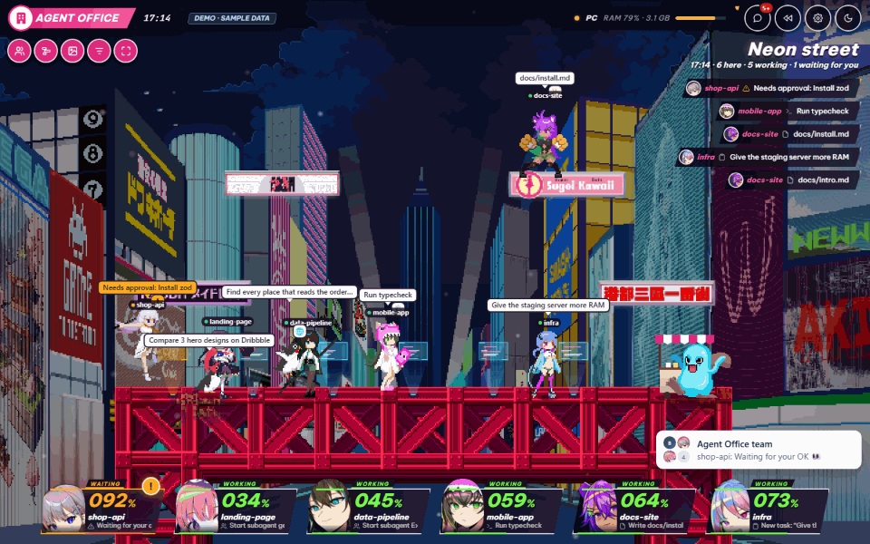

# Agent Office

English · [Tiếng Việt](README.vi.md)

A 3D office for your Claude Code sessions. Each session is a character at a desk: it walks to the library to read
files, types while it edits, goes to the server room to run commands, and launches a rocket when you deploy.



> A community project, not made by or affiliated with Anthropic.

## Quick start

Needs **Node.js 20.9+** and **Claude Code**. Runs on macOS, Linux and Windows.

```bash
git clone https://github.com/byocao/agent-office.git && cd agent-office
npm install
node bin/cli.mjs install --service   # add the hooks and run the office in the background
node bin/cli.mjs doctor              # check that everything works
```

Open <http://localhost:4310>. Just want a look first? Run `npm run dev` and open <http://localhost:4310/?demo>
(made-up sessions, no Claude Code needed).

`install` backs up `~/.claude/settings.json` first and only adds its own hooks. To remove everything:
`node bin/cli.mjs uninstall`.

## Commands

| Command | What it does |
| --- | --- |
| `install` | Adds the hooks, the status line and usage telemetry to Claude Code. |
| `uninstall` | Removes all of it and keeps the rest of your settings. |
| `doctor` | Checks each part and tells you how to fix what is missing. |
| `start` | Runs the server in this terminal. |
| `pin [--new]` | Shows (or changes) the PIN phones sign in with. |

Options for `install`:

- `--service`: start the office automatically at login.
- `--lan`: let phones on the same Wi-Fi open it.
- `--no-approve`: don't answer permission requests from the office.
- `--no-status`: leave your status line alone.
- `--no-otel`: don't turn on Claude Code's usage telemetry.

Logs are in `data/server.log`. `doctor` also prints how to restart the background service on your system.

## Features

**Watch your sessions**
- Every session is a person in the office. Subagents walk in, get their task and report back.
- Desk screens show what each one is doing. A messy desk means uncommitted files; a commit prints a page, a push
  launches the rocket, a failing CI run turns things red.
- A timeline and replay of the last hour or day, a weekly recap card, and trophies for milestones.

**Answer Claude from the office**
- Permission requests, questions and plans appear as cards (keys Y / N / A).
- Risky commands (`rm -rf`, force push, `sudo`, `curl | sh`, anything with "prod") are red and need two clicks.
- A session that hits the same error 3 times in a row is stopped and told to try something else.

**Keep an eye on your plan and your machine**
- Plan usage (5-hour and weekly limits) with warnings at 80% and 95%. Several Claude accounts, with automatic
  switching when one runs out.
- "What eats your plan": cost split by MCP server, skill, subagent, model and project.
- RAM, CPU and disk, forgotten dev servers, idle sessions, and one-click cleanup.
- Forgotten work: worktrees with uncommitted or unpushed changes.

**Use it from your phone**
- Same Wi-Fi, Tailscale, or anywhere through a Cloudflare tunnel. Signed in with a 6-digit PIN.
- Watch, approve (if you allow it on the computer), chat with a session or give Claude new work.
- Push notifications when Claude answers or needs you.

**Have some fun**
- Three floor plans, two character styles, city / countryside / beach backdrops, real weather and day and night.
- A living Vietnamese city outside, a team group chat, games, pool and karaoke for resting sessions.
- Walk around in first person (WASD, E to interact), photo mode (P) and 15-second clips.
- English and Vietnamese (Settings → Display). List mode turns off 3D to save battery.

## Privacy

- **Everything runs on your computer.** Hooks post to `127.0.0.1`. If the office is off, Claude Code works as usual.
- Strings that look like passwords, tokens or API keys are masked before they are stored or shown.
- Your Claude login is read from the system keychain each time and never stored.
- Phones can only connect after you turn it on, need the PIN, and can't approve anything unless you allow it.
- Every stop, cleanup and approval is logged in `data/actions.log`.

These network calls can be turned off:

| Call | Off switch |
| --- | --- |
| Plan usage | `OFFICE_USAGE=0` |
| GitHub CI status (through your `gh` login) | `OFFICE_CI=0` |
| Translating to Vietnamese | `OFFICE_TRANSLATE=0` |
| Weather | leave the city empty in Settings |

## Configuration

| Variable | Default | Meaning |
| --- | --- | --- |
| `OFFICE_PORT` | `4310` | Port |
| `OFFICE_HOST` | `127.0.0.1` | Address to listen on (`install --lan` sets it) |
| `OFFICE_LANG` | `en` | Default language (`en` or `vi`) |
| `OFFICE_DATA_DIR` | `data/` | Where the office keeps its files |

## Development

```bash
npm run dev                                    # http://localhost:4310/?demo with hot reload
npm run lint && npm run typecheck && npm test  # checks and unit tests
npm run build && npm run test:e2e              # end-to-end tests
```

| Part | Folder | Built with |
| --- | --- | --- |
| Server | `server/` | Node.js |
| Web page | `app/`, `src/components/` | Next.js |
| 3D office | `src/office/` | three.js |
| Text on screen | `src/i18n/locales/` | one folder per language |

More in [docs/ARCHITECTURE.md](docs/ARCHITECTURE.md) and [CONTRIBUTING.md](CONTRIBUTING.md).

## Credits

- Ideas from agents-at-work, cubicle-crew (MIT, dangerous-command patterns) and cc-reaper (Apache-2.0, RAM and CPU
  rules).
- [three.js](https://threejs.org) and qrcode.js (MIT); Be Vietnam Pro and JetBrains Mono fonts (SIL OFL).
- [Simple Icons](https://simpleicons.org) and [Kenney Car Kit](https://kenney.nl/assets/car-kit) (CC0);
  weather from [Open-Meteo](https://open-meteo.com).
- Shop and brand names (Circle K, GS25, 7-Eleven, WinMart, Grab, Xanh SM, Shopee, Mixue, Highlands Coffee and others)
  belong to their owners. Their shops are drawn in code; see `public/assets/brands/README.md`. Agent Office is not
  affiliated with any of them.

## License

[MIT](LICENSE)
