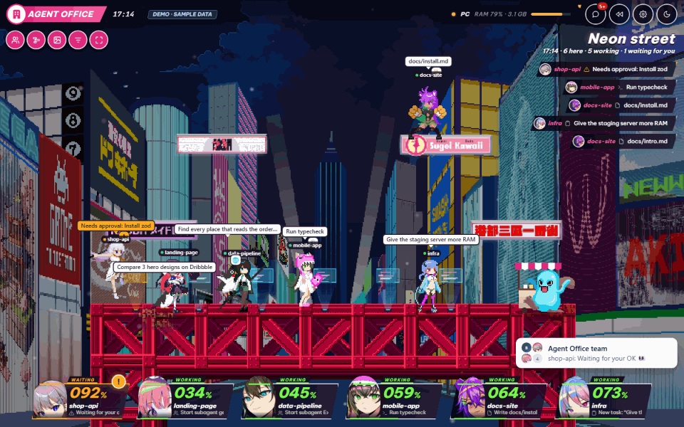
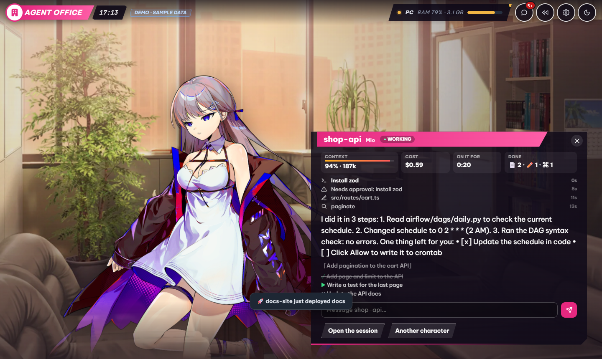
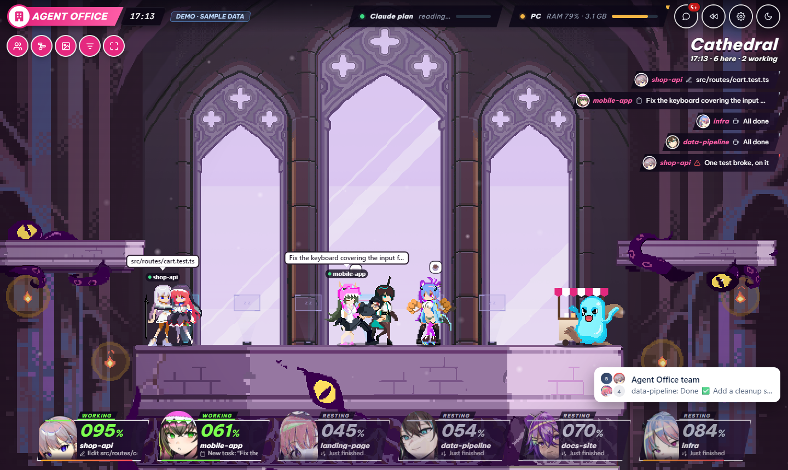

# Agent Office

[English](README.md) · Tiếng Việt

Các phiên Claude Code thành nhân vật trên sân khấu pixel nhìn ngang. Mỗi phiên có một màn hình hologram: đang làm thì
gõ phím, chờ duyệt thì nhảy kèm dấu "!", commit thì tung chiêu, nghỉ thì tự sống (nhảy lên bục, ra xe cà phê, tán gẫu hay
đấu tập với người khác). Bấm vào ai để mở cảnh visual novel: Live2D, AI đang làm gì từng bước, câu trả lời gần nhất và ô
nhắn lại cho nó. Hình, sân khấu và giọng nói lấy từ bản game của chính bạn (`scripts/vn-assets.py`), không nằm trong repo này.



| Bấm vào ai: cảnh của họ, AI đang làm gì, ô nhắn lại | Sân khấu khác: thánh đường |
| --- | --- |
|  |  |

> Dự án cộng đồng, không do Anthropic làm hay liên kết.

## Cài nhanh

Cần **Node.js 20.9+** và **Claude Code**. Chạy trên macOS, Linux và Windows.

```bash
git clone https://github.com/byocao/agent-office.git && cd agent-office
npm install
node bin/cli.mjs install --service   # thêm hook và chạy văn phòng ở chế độ nền
node bin/cli.mjs doctor              # kiểm tra mọi thứ đã chạy đúng
```

Mở <http://localhost:4310>. Muốn xem thử trước? Chạy `npm run dev` rồi mở <http://localhost:4310/?demo>
(phiên giả lập, không cần Claude Code).

`install` sao lưu `~/.claude/settings.json` trước khi sửa và chỉ thêm hook của mình. Gỡ toàn bộ:
`node bin/cli.mjs uninstall`.

Giao diện mặc định là tiếng Anh; đổi sang tiếng Việt ở **Cài đặt → Hiển thị** hoặc đặt `OFFICE_LANG=vi`.

## Hình nhân vật

Nhân vật, model Live2D, sân khấu và giọng nói được dựng ngay trên máy bạn từ bản game của chính bạn, vào
`public/assets/vn/` (git bỏ qua thư mục này):

```bash
pip install UnityPy pillow numpy
python -I scripts/vn-assets.py "<thư mục game>"            # sáu nhân vật nữ với màu riêng
python -I scripts/vn-assets.py "<thư mục game>" --original # giữ màu gốc của game
```

Chưa có hình thì văn phòng sẽ chỉ cách dựng. Bảng màu nằm trong `scripts/vn_recolor.py`.

## Lệnh

| Lệnh | Tác dụng |
| --- | --- |
| `install` | Thêm hook, status line và số liệu dùng (telemetry) vào Claude Code. |
| `uninstall` | Gỡ hết những thứ trên, giữ nguyên phần cài đặt còn lại. |
| `doctor` | Kiểm tra từng phần, báo thiếu gì và cách sửa. |
| `start` | Chạy server ngay trong cửa sổ terminal này. |
| `pin [--new]` | Xem (hoặc đổi) mã PIN để điện thoại đăng nhập. |

Tuỳ chọn của `install`:

- `--service`: tự chạy văn phòng khi đăng nhập máy.
- `--lan`: cho điện thoại cùng wifi mở được.
- `--no-approve`: không duyệt quyền từ văn phòng.
- `--no-status`: không đụng tới status line của bạn.
- `--no-otel`: không bật telemetry của Claude Code.

Log nằm ở `data/server.log`. `doctor` cũng in lệnh khởi động lại dịch vụ nền cho đúng hệ điều hành của bạn.

## Tính năng

**Theo dõi các phiên**
- Sân khấu chiếm cả cửa sổ, phủ một lớp HUD kiểu game: thẻ nhân vật cho từng phiên dọc phía dưới (gương mặt, % ngữ cảnh
  làm con số lớn, đang làm gì) và các nước đi mới nhất chạy dọc bên phải. Danh sách phiên và nhật ký hoạt động chỉ trượt
  ra khi bạn cần.
- Mỗi phiên là một nhân vật đứng ở màn hình hologram của mình trên sân khấu: xanh và chạy code khi đang làm, vàng kèm
  dấu "!" khi chờ bạn duyệt. Trợ lý (subagent) là chim cánh cụt đi theo sếp.
- Commit, push hay test xanh thì tung chiêu, bắn pháo giấy, người gần đó cổ vũ. Lỗi thì bị ngã và có người chạy lại hỏi.
  Phiên mới rơi từ trời xuống, phiên xong việc thì nhảy vụt đi.
- Bấm vào ai để mở cảnh visual novel: Live2D biết chớp mắt và nói, đồng hồ ngữ cảnh và chi phí, các bước AI vừa làm,
  câu trả lời gần nhất và ô nhắn lại (thành lượt mới, hoặc chen vào giữa hai bước khi đang làm).
- Dòng thời gian và xem lại 1 giờ hoặc cả ngày, thẻ tổng kết tuần.

**Trả lời Claude ngay trong văn phòng**
- Yêu cầu quyền, câu hỏi và kế hoạch hiện thành thẻ (phím Y / N / A).
- Lệnh nguy hiểm (`rm -rf`, force push, `sudo`, `curl | sh`, có chữ "prod") tô đỏ, phải bấm hai lần.
- Phiên gặp cùng một lỗi 3 lần liền thì bị chặn và được nhắc đổi cách khác.

**Theo dõi gói Claude và máy tính**
- Hạn mức gói (5 giờ và theo tuần), cảnh báo ở 80% và 95%. Hỗ trợ nhiều tài khoản Claude, tự đổi khi một tài khoản hết
  lượt.
- "Cái gì đang ăn gói": chi phí chia theo MCP, skill, subagent, model và dự án.
- RAM, CPU, ổ đĩa, dev server bị bỏ quên, phiên đang rảnh; dọn dẹp bằng một nút bấm.
- Việc bỏ quên: các worktree còn thay đổi chưa commit hoặc chưa push.

**Dùng trên điện thoại**
- Cùng wifi, qua Tailscale, hoặc ở bất cứ đâu qua đường hầm Cloudflare. Đăng nhập bằng mã PIN 6 số.
- Xem, duyệt lệnh (nếu bạn cho phép trên máy tính), nhắn tiếp một phiên hoặc giao việc mới cho Claude.
- Thông báo đẩy khi Claude trả lời hoặc cần bạn.

**Cho vui**
- Ba sân khấu (phố neon, thánh đường, khu trò chơi) có parallax và đèn neon động, camera trôi chậm và rung khi có
  chuyện lớn.
- Phiên đang nghỉ tự sống: nhảy lên bục, ra xe cà phê, tán gẫu hay đấu tập với nhau.
- Giọng nói trận đấu khi bạn chọn nhân vật, khi thắng và khi ngã (lúc bật âm thanh), thời tiết thật, ngày và đêm, nhóm
  chat công ty.

## An toàn

- **Mọi thứ chạy trên máy bạn.** Hook gửi tới `127.0.0.1`. Văn phòng tắt thì Claude Code vẫn chạy bình thường.
- Chuỗi giống mật khẩu, token, khoá API bị che trước khi lưu hay hiển thị.
- Thông tin đăng nhập Claude được đọc từ keychain mỗi lần dùng, không bao giờ lưu lại.
- Điện thoại chỉ kết nối được khi bạn bật, phải nhập PIN, và không duyệt được gì nếu bạn chưa cho phép.
- Mọi lần tắt tiến trình, dọn dẹp, duyệt quyền đều ghi vào `data/actions.log`.

Các kết nối mạng có thể tắt:

| Kết nối | Cách tắt |
| --- | --- |
| Hạn mức gói | `OFFICE_USAGE=0` |
| Trạng thái CI trên GitHub (qua `gh` đã đăng nhập) | `OFFICE_CI=0` |
| Dịch sang tiếng Việt | `OFFICE_TRANSLATE=0` |
| Thời tiết | để trống thành phố trong Cài đặt |

## Cấu hình

| Biến | Mặc định | Ý nghĩa |
| --- | --- | --- |
| `OFFICE_PORT` | `4310` | Cổng |
| `OFFICE_HOST` | `127.0.0.1` | Địa chỉ lắng nghe (`install --lan` tự đặt) |
| `OFFICE_LANG` | `en` | Ngôn ngữ mặc định (`en` hoặc `vi`) |
| `OFFICE_DATA_DIR` | `data/` | Nơi văn phòng lưu dữ liệu |

## Phát triển

```bash
npm run dev                                    # http://localhost:4310/?demo, tự nạp lại khi sửa
npm run lint && npm run typecheck && npm test  # kiểm tra và unit test
npm run build && npm run test:e2e              # test end-to-end
```

| Phần | Thư mục | Công nghệ |
| --- | --- | --- |
| Server | `server/` | Node.js |
| Trang web | `app/`, `src/components/` | Next.js |
| Quán cà phê | `src/office/` | canvas thuần |
| Chữ trên giao diện | `src/i18n/locales/` | mỗi ngôn ngữ một thư mục |

Xem thêm [docs/ARCHITECTURE.md](docs/ARCHITECTURE.md) và [CONTRIBUTING.md](CONTRIBUTING.md).

## Ghi công

- Ý tưởng từ agents-at-work, cubicle-crew (MIT, mẫu lệnh nguy hiểm) và cc-reaper (Apache-2.0, luật RAM và CPU).
- qrcode.js (MIT); font Be Vietnam Pro và JetBrains Mono (SIL OFL).
- [Simple Icons](https://simpleicons.org) (CC0); thời tiết từ [Open-Meteo](https://open-meteo.com).
- Live2D chạy bằng [pixi-live2d-display](https://github.com/guansss/pixi-live2d-display) (MIT) và Cubism Core for Web
  của Live2D, do `vn-assets.py` tải từ Live2D theo giấy phép riêng của họ.
- Nhân vật, sân khấu và giọng nói thuộc về hãng làm game; chúng không nằm trong repo này.

## Giấy phép

[MIT](LICENSE)
